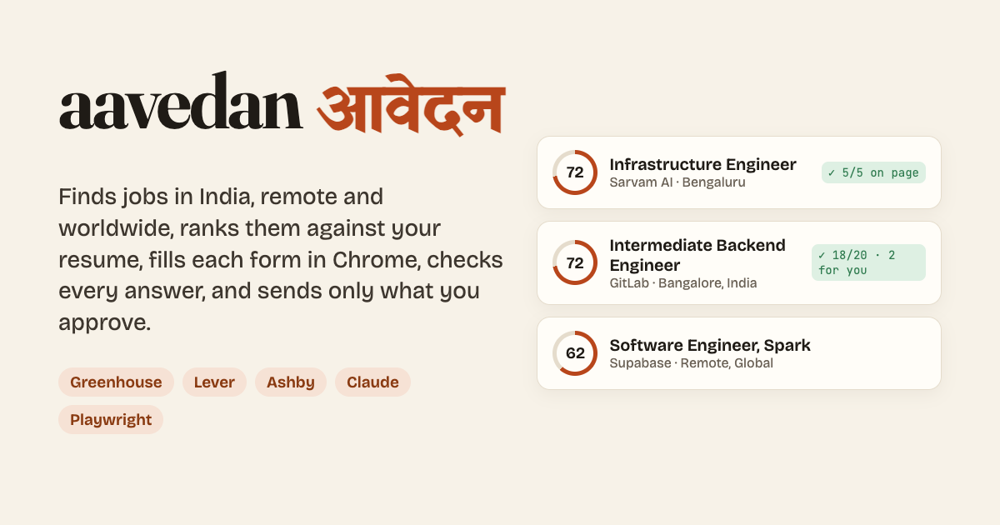
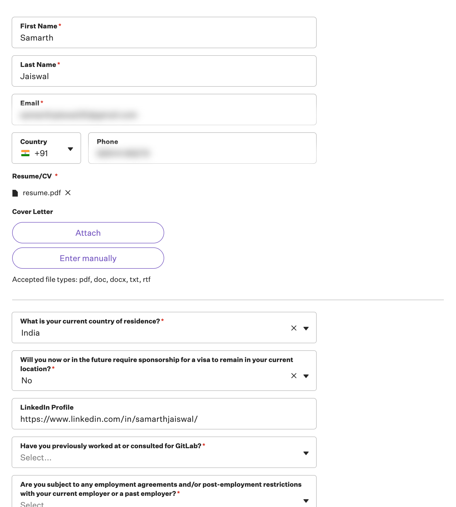

# aavedan आवेदन

[](https://samarthjaiswal.github.io/aavedan/)
[](https://github.com/SAMARTHJAISWAL/aavedan/actions/workflows/ci.yml)
[](LICENSE)

*आवेदन* (aavedan) is Hindi for "application", the kind you send for a job.

**A job search that does the tedious part and leaves the decisions to you.** aavedan reads the public job boards of about fifty companies hiring in India, remotely and worldwide. It drops the jobs you can't or wouldn't take, ranks the rest against your resume, and writes a one-page resume for each job. Then it fills in the application form in a Chrome window you can watch. It reads every answer back from the page, asks you whatever only you can answer, and sends a form only when you say yes.

It runs on your own computer, using your own Claude API key. There is no server and no account, and nothing about you leaves your machine except the Claude calls themselves.

**[See the board for my own job search →](https://samarthjaiswal.github.io/aavedan/)**



The live demo is my own search: real postings ranked against my resume, and three rehearsed applications, with nothing sent. My contact details and CTC never leave my machine.

## What it does

```
aavedan find                         aavedan apply a18                         aavedan apply a18 --send
     │                                    │                                          │
     ▼                                    ▼                                          ▼
 Read ~8,600 postings from           Open the form in Chrome, read            Read the page once more,
 Greenhouse, Lever and Ashby         every question, its options,             click Submit, wait for the
     │                               and whether it is required               board's confirmation
     ▼                                    │                                          │
 Rules, no model: place, level,           ▼                                          ▼
 years asked, role, age              Claude maps each question to a           me/applications.csv
     │                               fact in your profile; the few            and the board page
     ▼                               open questions are written
 Claude rates what is left:          from your profile and checked
 fit 0–100, why, the gaps,                │
 and whether you are eligible             ▼
     │                               Type, pick, attach; then read
     ▼                               every answer back from the page
 A ranked queue                      and show you what would hold it
```

A rehearsal (`apply` without `--send`) does everything except click Submit. This is GitLab's real Greenhouse form, filled from my own resume in a rehearsal. My email and phone are blurred here. The two questions only I can answer are left for me:

<p align="center"></p>

## What it never does

- **It never invents a fact.** Your profile (`me/profile.json`) is the only source. Every number and every proper name in a tailored resume, cover letter or written answer is checked *in code* against your profile and the posting. Anything unsupported is rewritten once, then dropped. Keywords the posting wants and your profile doesn't show are listed for you, never slipped in.
- **It never bends your work rights to fit a form.** Questions about authorization and sponsorship are answered from your profile. Code rejects any answer that disagrees with it, and the form waits for you.
- **It never guesses what only you know.** That covers a past job at the company, a referral, a relative there, an employment agreement, a consent, a background check, or a salary figure you haven't given. Code enforces it: even when Claude offers an answer to one of these, it is thrown away and you are asked. Your answer is remembered for the next form.
- **It never sends without your yes.** At the keyboard you approve each form. In Claude Code, you approve each job by name, in the chat.
- **It never touches a human check.** If a board shows a CAPTCHA, the form waits in its tab for you.
- **It never works around a board that says no.** Some boards (Lever, for one) reject applications from an automated browser. aavedan then **hands off**: the tailored resume goes to your Downloads folder, an answer sheet with a Copy button for every answer opens in your own browser next to the form, and you click Submit yourself. It remembers the board, so later applications there go straight to hand-off. `aavedan done <id>` records it as sent.

## How it is different

| | |
|---|---|
| **India, remote and worldwide** | Rules understand Bengaluru/Bangalore, Gurugram/Gurgaon, "Delhi NCR", "Remote - India", APAC, and remote roles that are really limited to one region ("Remote - US", "EMEA", a remote flag on a Vienna office). Forms that ask for notice period, current and expected CTC in LPA, or Indian cities get answers from the profile. |
| **Your Claude API key** | A cheap, fast model (Claude Haiku 5.5) makes the decisions: fit scores, which detail goes in which box. A stronger one (Claude Opus 5.5) writes the sentences. It runs as a plain command-line tool and also as Claude Code skills. |
| **Reads forms like a person** | Searchable dropdowns that show your choice outside the input, Yes/No buttons with no input behind them, uploads that turn into a filename chip, and location boxes that keep only a picked suggestion. It types the city and takes the board's own spelling ("Bengaluru, Bengaluru Urban, Karnataka, IND"). |
| **A board page** | `aavedan board --open` writes one HTML file with your queue, what waits for you, and every application. The [live demo](https://samarthjaiswal.github.io/aavedan/) is that page. |

## Quick start

You need Node.js 22.18 or newer, Google Chrome, and a [Claude API key](https://platform.claude.com).

```bash
git clone https://github.com/SAMARTHJAISWAL/aavedan
cd aavedan
npm install
npm link            # makes the `aavedan` command available
cp .env.example .env
```

Paste your key into `.env`, then:

```bash
aavedan init ~/Documents/resume.pdf   # reads the resume, then a two-minute interview
aavedan find                          # read the boards, rank the jobs
aavedan list
aavedan apply a18                     # rehearse one: fill, read back, send nothing
aavedan apply a18 --tailor --send     # tailor the resume, fill, and send it if you say yes
```

### In Claude Code

Open `claude` in the folder and type `/setup`. The skills run the same commands and ask you, in the chat, whatever a form needs.

| Skill | What it does |
|---|---|
| `/setup` | Checks the machine, reads your resume, asks what a resume doesn't say, and rehearses your first application |
| `/find` | Reads the boards and shows the best jobs, with why each one fits |
| `/apply [id or link]` | Rehearses, asks what only you know, then sends the jobs you name |
| `/tailor <id>` | A one-page resume (and cover letter) for one job, as PDFs |
| `/status` | Sent, waiting for you, the queue, and what Claude has cost |
| `/board` | Opens your board page |

## Commands

| Command | |
|---|---|
| `aavedan init <resume.pdf>` | Read the resume into `me/profile.json`, then ask about work rights, roles, places, notice period and CTC |
| `aavedan find [--rank 60]` | Read every board, apply your rules, rate new jobs |
| `aavedan list [--all]`, `aavedan show <id>` | The ranked queue; one job's fit, matches and gaps |
| `aavedan tailor <id> [--cover]` | Resume and cover letter PDFs in `me/tailored/` |
| `aavedan apply <ids or links>` | Rehearse: fill and read back, send nothing |
| `… --send` | Send each complete form you approve |
| `… --tailor --cover` | Tailor first, and attach a cover letter |
| `… --send --no-input --yes` | Unattended (scripts, Claude Code): send what is complete, hold the rest |
| `aavedan handoff <id>`, `aavedan done <id>` | Send it from your own browser with every answer ready; then record it as sent |
| `aavedan answer "<question>" "<answer>"` | Save an answer that later forms reuse |
| `aavedan add-company <board link>` | Read another company's Greenhouse, Lever or Ashby board |
| `aavedan status`, `aavedan board --open` | Where you stand; the board page |

A posting link from any Greenhouse, Lever or Ashby board works in place of an id: `aavedan apply https://jobs.lever.co/acme/…`.

## What it costs

These are measured on real runs:

| Step | Model | Cost |
|---|---|---|
| Read your resume once | Opus 5.5 | about $0.036 |
| Rate one job | Haiku 5.5 | about $0.0005; a find that rates 60 jobs costs about 3 cents |
| Map one form | Haiku 5.5 | about $0.001 |
| Tailored resume / cover letter | Opus 5.5 | about $0.03 each |

A rated job is cached and never rated twice. `aavedan status` shows what you have spent.

## Where the jobs come from

These are the public JSON APIs that Greenhouse, Lever and Ashby publish for every company's job board. Nothing is scraped and there is no sign-in. The default list ([src/sources/companies.ts](src/sources/companies.ts)) covers 52 companies, checked live:

- **Hiring in India:** Paytm, Meesho, CRED, Razorpay, Zeta, Sarvam AI, Groww, Tekion, InMobi.
- **Global companies with Indian offices:** Databricks, Stripe, MongoDB, Okta, Zscaler, Snowflake.
- **Remote-first:** GitLab, Supabase, PostHog, Sentry, Linear, and others.

Add any other company with `aavedan add-company`.

Naukri, LinkedIn and Workday are left out on purpose. They need an account, and their terms don't allow automated applying.

## Privacy

Everything about you stays in `me/`, which is git-ignored:

- your profile;
- your resume;
- the queue;
- your answers;
- your records;
- the Chrome profile the tool uses.

Text goes to the Claude API only for the calls above. The live demo and the screenshots show only my name, the ranked jobs and the rehearsals: no contact details or salary. The automated tests use a made-up test profile, so no real person's data is in the code.

## Development

```bash
npm test          # 62 tests: rules, board readers, fact check, and browser tests on local forms
npm run typecheck
```

- **Browser tests:** these run the real form reader and filler in headless Chrome. The forms they use are small pages written for the tests that copy each board's *patterns*:
  - labels in sibling elements;
  - searchable dropdowns;
  - Yes/No buttons;
  - checkbox groups.
- **End-to-end test:** one test sends a whole application to a local server and checks the board's confirmation and the record.
- **Notes for Claude Code:** see [CLAUDE.md](CLAUDE.md).

## Credit

The idea comes from [qbeka/jev-job-search](https://github.com/qbeka/jev-job-search), a job-application tool built on Claude Code for students in Canada and the US. aavedan is a separate project, written from scratch, with its own design:

- jobs in India as well as remote and worldwide;
- your own Claude API key;
- code-level fact checking;
- a board page.

## Licence

[MIT](LICENSE) © 2026 Samarth Jaiswal
